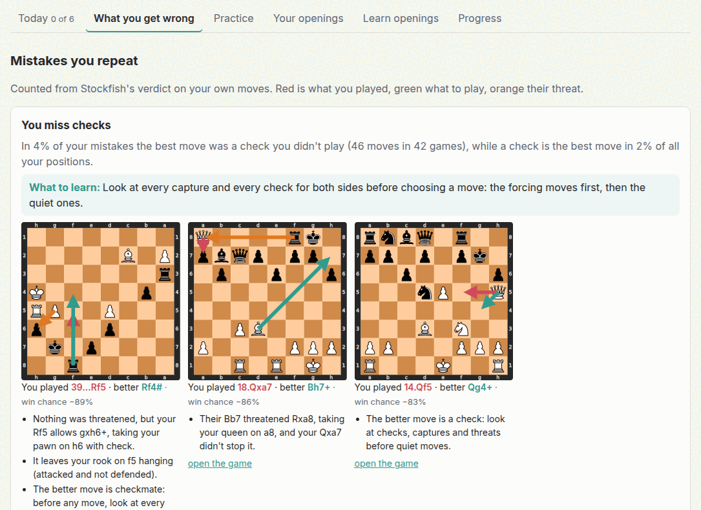
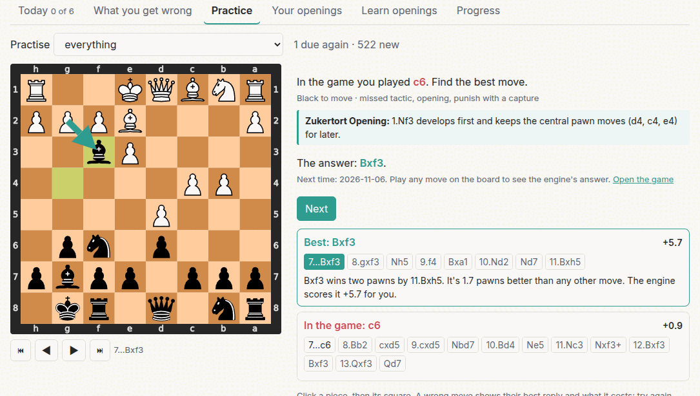
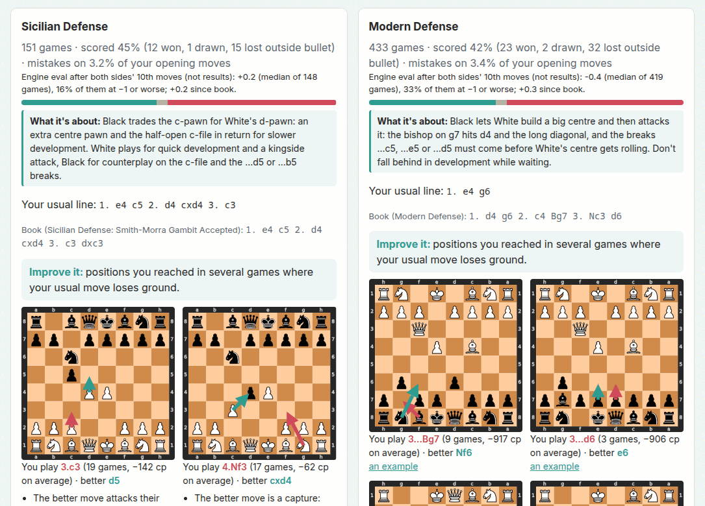
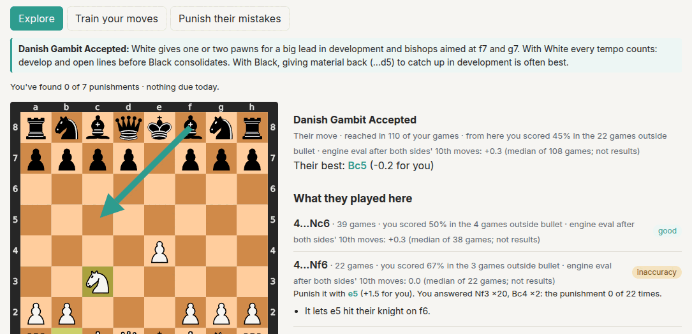
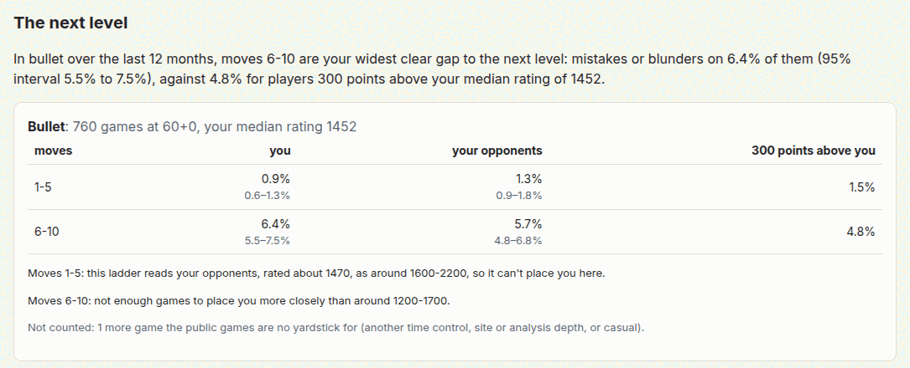

# chess-coach

A coach that reads *your* games, finds the patterns behind your losses, explains them in
plain language, and trains you on exactly those spots.

## What it is

- Pulls your games from Lichess and Chess.com.
- Runs Stockfish over every game to find mistakes, blunders, and missed tactics.
- Instead of the usual per-game "you blundered on move 23", it looks *across* games and
  explains recurring patterns: "you lose when you castle late against the London",
  "you trade queens when behind in development", "you miss back-rank threats after
  move 30 in blitz".
- Generates puzzles from your own positions targeted at those weaknesses, with spaced
  repetition so the ones you keep failing come back.
- Weekly digest: what changed, what to work on next, one opening line to study.

`chess-coach serve` on the author's own Lichess games (2,091 of them, all analysed).

The mistakes you repeat, on your own positions (red arrow: what you played; green: what to
play), with what to learn:



Practice on your own mistakes. After an answer, step through the best line next to the move you
played in the game (here 8...Nxf2+ forks king and rook; the game went 8...Nxe5):



Your openings, with your score, your usual line and the habitual moves worth fixing:



Learn openings: the tree of your own games. Where the opponent went wrong it shows the
punishment, how you actually answered (4...Nf6 in the Danish: met 21 times, punished 0 times) and
why it's a mistake in chess terms:



Your rating week by week next to the practice you did (bullet left out):



## Why build it

Because generic chess trainers don't know you, and a coach that says "here's the
mistake you make every Tuesday" is worth more than a hundred random puzzles. Also
because it is a satisfying shape of project: a hard, exact engine does the truth-finding
and the language model does the explaining — and you can check whether the explanation
was right.

## How it works

```
Lichess / Chess.com APIs, PGN files ──► game store (SQLite, on your machine)
        │
        ▼
Stockfish analysis ──► per-move facts: eval swing, best move and line, motifs, clock
        │
        ▼
pattern mining ──► the situations, moves and openings where you go wrong more than usual
        │
        ├──► digest (Markdown) and the web coach, every claim linked to your moves
        ├──► optional plain-language summary by a model, checked against the evidence
        └──► puzzles from your own mistakes (engine-verified) + spaced repetition drills
```

- **The engine is the source of truth.** The model never judges a move; it explains
  facts the engine established, and every claim cites game IDs and move numbers.
- **Patterns first, explanations second.** Clustering happens in code; the model
  narrates clusters, which keeps hallucinated "patterns" out.
- **Puzzles are verified**: a puzzle only ships if Stockfish confirms a unique, clearly
  better solution.

## What gets measured

- Your mistake rate, centipawn loss and score by month or week (`progress`), with bullet after
  move 10, bullet results and moves made short on time left out.
- Puzzle solve rate per theme, from every attempt.
- Your rating week by week next to the puzzles and opening training you did (`progress`, and
  the Progress page), read from your own games (each stores the rating before the game; bullet
  is left out). Once there are four weeks with practice and four without, it compares how the
  rating moved in each: a comparison, not proof.
- How accurate the model's summaries are, graded by hand: `eval narrate` has the model
  summarise five digests (all games, then the last year, 6, 3 and 1 month) and writes every
  sentence to a sheet next to the facts it was given; you grade the sentences the automatic check
  kept (y: the facts support it, n: they don't, ?: can't tell); `eval score` reports y / (y + n).

## Privacy

Your games, analyses and puzzle history stay in a SQLite file in `data/` on your machine. The
only network calls are the Lichess and Chess.com game exports (public APIs) and, if you ask for
one, the model summary: `--narrate` sends the counted patterns and the cited moves to the model
server you choose (a local Ollama by default), not the games themselves. `serve` binds to localhost and
has no login, so keep it there.

## Stack

Python 3.12 (uv), a Typer + Rich command line, python-chess, Stockfish 19 over UCI, SQLite for
games and per-move facts, and the CC0 [lichess-org/chess-openings](https://github.com/lichess-org/chess-openings)
table for opening names. The web coach is FastAPI with plain JavaScript and python-chess boards.

## Milestones

- **v0 (done)** — import games, run engine analysis, store per-move facts with motif tags.
- **v1 (done)** — pattern mining + a plain-language digest citing games, with an optional
  model-written summary checked against the evidence.
- **v2 (done)** — puzzle generation and spaced repetition drills.
- **v3 (done)** — weekly digests, opening study suggestions, progress tracking.
- **v4 (done)** — the coach in the browser: your recurring mistakes on boards (your move in red,
  the better one in green) with what to learn, click-to-move practice, and your favourite
  openings with the habitual moves to fix and drills for them.
- **v5 (done)** — learn from it: wrong puzzle answers you can explore (their reply, what it costs,
  try again, step through the lines, play any move against the engine), reasons in chess terms
  from the board, and Learn openings: your openings as a tree from your games, with the
  punishment for each opponent mistake and training modes.
- **v6 (done)** — opening training is remembered: every position you answer becomes a card on
  a spaced-repetition schedule, due ones come first, and each opening shows how many
  punishments you've found.
- **v7 (done)** — rating trend against practice: your rating week by week next to the puzzles
  and opening training you did.
- **Today (done)** — a session you can finish: 10 items a day, reviews first, at most 5 new.
- **The next level (done)** — your early-game errors against public Lichess players by rating.

## Status

**v0–v7 done.** Import, analyse, find your patterns, turn your own mistakes into puzzles, drill
them on a schedule, learn and fix your openings, and watch the numbers move, in the terminal or in
the browser (`chess-coach serve`). New: *When they blunder* (`punish`), what your replies to your
opponents' blunders give back against what theirs give back after yours. On the author's games,
bullet moves 1-10: the reply took only part of the gift (gave back 10-20 points) after 14.7% of
their blunders against their 8.2% (+6.5 points, 95% interval +2.8 to +10.3), while clear misses
(20+) show no clear difference, 29.3% against 28.1% (+1.2, -4.0 to +6.5); blitz and rapid: no
clear difference on either.

**Bullet is not taken seriously.** In a 1-minute game only your first 10 moves count: after
that the clock decides the game, so later moves are left out of everything (patterns, mistake
rates, openings, progress, puzzles), and bullet results never count towards a score or a loss
rate. Problems in those first 10 moves are found like any others.

**Short on time doesn't count either.** In other games a move played with under a tenth of the
clock left is a reflex, so it's left out of the patterns, mistake rates, progress and new puzzles.
Those mistakes only show up, in their own section, when the same one keeps happening: 15+ times
across 8+ games.
[docs/PLAN.md](docs/PLAN.md) has the build plan and how to pick the work up.

- `import lichess|chesscom|pgn` stores games in SQLite with your colour, the speed (Lichess's
  rule) and the opening: Lichess's own header when it has one, otherwise the longest matching
  line in the lichess-org opening table. Re-imports never duplicate a game.
- `analyze` asks Stockfish about every position once and stores, per move: the evaluation
  before and after from the mover's side, the best move and line, centipawn and win-probability
  loss, a Lichess-style judgement (inaccuracy, mistake, blunder), the game phase, the clock, and
  motif tags. It resumes where it stopped and re-runs only at a greater depth (or `--force`).
- `sync` does import, analyse, `puzzles make` and `threats` for you: it fetches every game since
  the newest one stored for each Lichess and Chess.com account (all or nothing, so a failed
  download leaves no gap), analyses whatever isn't analysed yet, newest first, makes puzzles,
  looks for their threats before every mistake not checked yet (the first time, the whole
  backlog), and ends with what's left to practise today. Bullet results aren't reported, by the rule
  above. When a new game repeats one of your repeated mistakes (see `repeats`) it says so: "You
  played 3...Bg7 again (12th time); it has a puzzle."
- `stats` prints a per-game accuracy table and how often each motif shows up in your moves.
- `threats` asks, before every counted mistake and blunder (yours and your opponents'), what the
  other side threatened: the mover passes and Stockfish (depth 12) finds their best line, and a
  second search finds their best answer to the move played. A mistake is an *ignored threat*
  (their last move threatened mate or material and your move didn't meet it) or an *unsafe move*
  (nothing was threatened, but your move allowed a reply that mates or wins two pawns' worth or
  more). Material is counted along the engine's line until the captures stop, never from the
  evaluation alone, which would count your own missed chances as their threats. It shows each
  share of your mistakes next to your opponents', with 95% intervals, and only calls one yours to
  work on when you clearly do it more often than they do (on the author's games: ignored threats,
  12% of their mistakes against 9% of their opponents', a gap only just clear of zero). About a
  minute for 2,500 mistakes; one thread (the default) gives the same labels on every run, more
  threads make a few vary. Resumable, and `sync` runs it on whatever isn't checked yet.
- `digest` slices your moves by phase, colour, speed, opening, move number and clock (and
  pairs of them), and your games by colour, speed, opening, castling and queen trades. It keeps a
  slice only when it has enough moves (30) or games (8), your mistake rate (or loss rate) there
  is well above your own (1.5×, or 1.25× for losses), and the low end of its 95% interval is
  still above it. Each pattern cites its worst moves with links; then a motif table with one
  thing to practise for each, and the mistakes you repeat from the same position. All counted, no
  model, so it can't invent a pattern.
- `digest --since 7d` is the weekly digest: only those games, compared with the ones before.
  `digest --narrate ollama` adds a short summary from a local model (free); `--narrate
  openrouter --model …` uses any OpenAI-compatible server with `OPENROUTER_API_KEY`. The model
  only explains: any sentence that cites a move outside the evidence is removed. It checks moves,
  not every word, so read it as a gloss on the counted patterns above it.
- `punish` (and a *When they blunder* section in the digest and on What you get wrong): when your
  opponent blunders (loses 20+ points of win probability), what your reply gives back: under 10
  points it kept the gift, 10-20 it took only part of it (a partial miss), 20 or more it missed
  it (a clear miss). Each is set against your opponents' replies to your blunders: players at
  your level with the same kind of chance. Bullet (moves 1-10, on both sides) and blitz + rapid
  (with any slower games, named in the label) are compared apart, with partial misses, clear
  misses and the two together as three rows, each with a 95% interval for the gap; you're only
  called worse or better when that interval leaves out zero, and the headline names no other
  gap (when neither part has one, the two together can). A row without a gap says no clear
  difference, or too few to tell while the interval still allows 10 points either way, never
  that you're the same. Where you take only part of it more often than your opponents there is
  a lesson (compare checks, captures and threats before your usual move, and take the one that
  wins most) and typical partial misses on boards (with a reason in chess terms, near the middle
  of the band). The rest counts a miss as partial or clear together (the engine's
  `missed_tactic`: the reply lost 10+ points): the same by the kind of punishing move (capture,
  check, quiet; a lesson only when you miss a kind more than your opponents do), the trend in
  stretches of about 150 chances, and on boards, with what the blunder allowed in chess terms:
  the openings where you clearly miss more than your opponents (only inside a group where you
  do, with 10+ chances on each side, and a gap clear of zero even allowing for how many openings
  were looked at), each with examples of the part (partial or clear) behind most of its gap; or
  else examples of the gap in those groups, or with no gap your costliest misses. Puzzles from a
  missed punishment are tagged `punish_capture`, `punish_check` or `punish_quiet` to drill apart;
  puzzles start at 20 points lost, so these are all clear misses.
- `puzzles make` re-checks your costliest moves (20+ points of win probability lost) at depth 18
  with three lines, and keeps a position only when one move is the only mate or beats the next
  best by 150 centipawns, so there is one answer to find. `puzzles list` shows them with their
  motif tags.
- `levels` compares how often you make a mistake or blunder early in a game with public Lichess
  players at each rating, from your last 12 months: bullet moves 1-5 and 6-10, blitz moves 1-5,
  6-10 and 11-20. Your opponents can't show this, because rating matching makes you level with them
  almost everywhere. The public games are scored the same way, with the same bullet and
  short-on-time rules (`scripts/level_reference.py`), and what most separates one rating from the
  next is accuracy early on. Only rated Lichess games analysed at depth 12 count. Your interval is
  read off that ladder as a range of ratings: wider than 300 points, it says "not enough games to
  place you" and gives only the range it can. Your opponents' rating is known, so the ladder is
  tried on them too, and where it misreads them it won't place you. On the author's bullet games,
  moves 6-10 are the clear gap: 6.4% (95% interval 5.5 to 7.5) against 4.8% for players 300 points
  higher. Twelve months of games still only place the author around 1200-1700. The card is also on
  Progress, with one line in the digest.
- `today` opens the day's session in the browser (`--cli` for the terminal, `--status` for one
  line: "Today: 10 to practise (about 5 min): 5 due again, 5 new"). It is 10 items: what's due
  again and due opening positions first, most overdue first, then at most 5 new puzzles, from
  the positions you reached in 2 or more games, then your games of the last 90 days, then the
  rest. Never two new ones from one game, and two from one game never in a row unless nothing
  else is left. It is worked out from today's answers, so an answer given in Practice or Learn
  openings counts too. The day changes at 4 am your time.
- `drill` shows each puzzle due again, then new ones, as a board from your side, takes your
  answer in SAN or UCI, shows the engine's line, and schedules the puzzle with SM-2: solved ones
  come back later and later, missed ones tomorrow. Every attempt is kept. A new puzzle isn't
  "due" until you've tried it, and a puzzle the bullet rule leaves out is never served, though
  its history stays.
- `progress --by month|week [--speed blitz]` shows your games, score, mistake rate and centipawn
  loss over time, and your puzzle solve rate overall and per tag.
- `openings` lists the openings you score worst in (by your colour), the book line for the one
  you play most, and the opening mistakes you have repeated in more than one game. Then every
  opening by the **engine eval after both sides' 10th moves (not results)**, so bullet games
  count too: the median eval, the share of games at -1 or worse and your mistake rate on moves
  1-10 (each with its 95% interval), and what you lost since book, so a gambit's pawn isn't put
  down to you. The eval is read after Black's 10th move whatever your colour: with Black that is
  your own 10th move, so a slip there counts; with White, read right after your own 10th move it
  would always include your last slip and never their reply. Since book counts from the last
  position the opening table names, or from just before it when a White move reached it (that
  move then counts too), so both sides make the same number of moves. Worst first by the mistake
  rate's interval, then that loss.
- `repeats` lists the same mistake from the same position in 3 or more games (inaccuracies or
  worse; named book moves left out; a position reached by another move order is the same
  position): the better move, their best answer and how often they found it, the reasons in chess
  terms, links to the games, and whether a puzzle drills it.
- `serve` opens the coach on http://127.0.0.1:8765 (localhost only, no account or key):
  - **What you get wrong**: the mistakes you repeat (which piece and kind of move, captures or
    checks you keep missing, motifs) and the situations where your mistake rate jumps, each with
    a *what to learn* note and your own positions on boards: red arrow your move, green the
    engine's, orange their threat (from `threats`), said in words. "Practise these positions"
    opens the matching drills. Then the same mistake in the same position (as `repeats`), each on
    a board with their best answer. A small section compares your ignored threats and unsafe
    moves with your opponents', and *When they blunder* is `punish` on the page.
  - **Today** opens first: the day's session on Practice's board, with how far you are ("4 of
    10"). When it's over, a panel gives tomorrow's counts, the days you practised of the last 7,
    and how you do on reviews against first tries.
  - **Practice**: every puzzle due again ("N due again · M new"), then new ones, on a board you
    click (piece, then square), filtered by theme. A
    wrong move shows their best reply, what it costs in material and score, and lets you try
    again (only the first answer counts for the schedule). Once it's solved or shown you get the
    best line, each of your tries and your game move as lines to step through (◀ ▶ or the arrow
    keys), and any move you play on the board is answered by Stockfish (depth 16, if installed).
    A puzzle from a threat you ignored first asks "What do they threaten?" (click their move;
    any move to the same square counts; you can skip), then the puzzle with the threat in orange.
  - Every wrong move, example and opening fix also gets reasons in chess terms, worked out from
    the board by `coach/principles.py` (no model): a piece left hanging, castling given up, the
    pawns in front of your castled king pushed, the queen out early, development skipped, a
    centre pawn given away, pawns doubled or isolated, a passed pawn allowed; and what the better
    move does instead (mates, checks or captures, attacks a piece, castles, develops, takes the
    centre, activates the king or pushes a passed pawn in the endgame). Openings you play get a
    short note on what they are about.
  - **Your openings**: your most-played openings with each colour, score, your usual line, the
    book line, and the fixes: positions you reached in several games where your habitual move
    loses ground (named book moves are never flagged), with "Drill these fixes"; and how each
    opening comes out by the engine after both sides' 10th moves, as in `openings`.
  - **Learn openings**: your most-played openings with each colour as a tree of the moves
    actually played in your games (first 8 moves each), with how often each came up, how you
    scored after it and the stored engine verdict. Where your opponent went wrong, it shows the
    punishment (the engine's answer and the score it gives you) and how you actually answered in
    your games. Three modes: *Explore* the tree; *Train your moves*, where they play the replies
    you meet as often as you meet them and you find a sound answer (your usual move if the engine
    rates it fine, else within 0.3 of the engine's best; the engine takes over where your games
    stop); and *Punish their mistakes*, every opponent mistake you've met twice or more, one at a
    time. Your practice is remembered: each position you answer becomes a card scheduled like a
    puzzle (only your first answer of the day counts; showing the move counts as a miss). Due
    punishments come first in the deck, training steers their replies towards positions that are
    due, and each opening shows "you've found 3 of 7 punishments" and how many are due. Each
    position and move also shows where the games through it stand after both sides' 10th moves.
    A wrong move in training plays out what happens next on the board, from the engine's line:
    "If you play 5.Qd5, they answer 5...Nxd5, taking your queen on d5. By 9...Bd7 you have lost the
    queen." Each move says what it does, in chess terms worked out from the board, and you can
    step through the line and try again. Where there is no real punishment it says so.
  - **Progress**: month by month, your rating and practice week by week (pick the speed), and
    your puzzle solve rate per theme.
- `puzzles make --openings` turns those opening fixes into drills; any move within 30 cp of the
  best counts, since openings often have several good moves. `puzzles prune` drops untried
  puzzles that no longer count (bullet after move 10, moves made short on time). A position is
  drilled once, however the game got there: a slip repeated from the same position, or a fix two
  openings share, adds its tags to the puzzle already there. `puzzles dedupe` merges the copies
  made before that (keeping the one you've tried, else the oldest; a tried puzzle is never
  deleted).

Motif tags are computed in code from the board and the engine's facts, never by a model:

| Tag | When |
|---|---|
| `hanging_piece`, `hanging_pawn` | the best reply captures something of yours that was undefended, or worth more than the piece taking it |
| `allowed_fork`, `missed_fork` | the best reply attacks two of your pieces (the king, pieces worth more than the attacker, or undefended ones), or your best move would have done that to the opponent |
| `allowed_mate`, `missed_mate` | your move let a forced mate in, or skipped one (up to mate in 6) |
| `back_rank` | that mate is a rook or queen mate on the king's back rank |
| `missed_tactic` | the opponent's previous move lost 20 points of win probability or more, and you didn't punish it |
| `pawn_grab` | an error that captured a pawn |
| `time_trouble` | under 20 s, or under 10% of the starting time, after the move |
| `endgame_conversion` | a winning endgame (+2 or better) let slip below +1 |
| `queen_trade_behind` | before the endgame you traded queens, or allowed the trade, while two or more steps behind in development (minor pieces off their home squares, king moved) |

All tags except `queen_trade_behind` are only set on inaccuracies or worse.

On 84 rated blitz games of a ~1500 Lichess player, analyzed at depth 12, `stats` ends with:

```
      Motifs on your 2626 moves
┏━━━━━━━━━━━━━━━━━━━━┳━━━━━━━┳━━━━━━━┓
┃ motif              ┃ moves ┃ games ┃
┡━━━━━━━━━━━━━━━━━━━━╇━━━━━━━╇━━━━━━━┩
│ missed_tactic      │    37 │    26 │
│ time_trouble       │    30 │    13 │
│ hanging_piece      │    29 │    23 │
│ pawn_grab          │    26 │    23 │
│ endgame_conversion │    17 │    12 │
│ hanging_pawn       │    12 │    12 │
│ allowed_mate       │    10 │     8 │
│ missed_fork        │     6 │     6 │
│ allowed_fork       │     4 │     4 │
│ missed_mate        │     2 │     2 │
│ back_rank          │     2 │     2 │
└────────────────────┴───────┴───────┘
```

## Getting started

```sh
uv sync                     # install
scripts/get-stockfish.sh    # fetch a Stockfish binary into ./.stockfish (no sudo needed)

uv run chess-coach import lichess <username> --max 100 --rated   # LICHESS_TOKEN raises the rate limit
uv run chess-coach import chesscom <username> --since 3m
uv run chess-coach import pgn games.pgn --user "<your name in the PGN>"
uv run chess-coach sync                                          # later: fetch, analyse, make puzzles
uv run chess-coach today                                         # today's practice, in the browser
uv run chess-coach games                                         # what is stored
uv run chess-coach analyze --depth 12 --threads 4
uv run chess-coach stats
uv run chess-coach threats                                       # ignored threats vs unsafe moves
uv run chess-coach digest -o digest.md                           # patterns across your games
uv run chess-coach digest --since 7d                             # this week vs before
uv run chess-coach punish                                        # when they blunder: you vs them
uv run chess-coach puzzles make --limit 50                       # your mistakes as puzzles
uv run chess-coach drill                                         # practise beyond today's session
uv run chess-coach progress --by week
uv run chess-coach levels                                        # your early errors against public players
uv run chess-coach openings                                      # incl. the eval after both sides' 10th moves
uv run chess-coach repeats                                       # the same mistake, same position
uv run chess-coach puzzles make --openings                      # drills for your opening fixes
uv run chess-coach puzzles dedupe                                # merge puzzles stored twice
uv run chess-coach serve --open                                  # the coach in your browser
```

`analyze --newest` starts with your latest games, so a big import is useful early.

After the first import, `sync` keeps the coach current in one step: new games from every Lichess
and Chess.com account already stored, analysis, puzzles from the new mistakes, and their threats
before the mistakes not checked yet. Run it daily or weekly (`--threads 8` speeds it up).

`--db <file>` picks another database. Without it the database comes from `CHESS_COACH_DB`, then
`db` in `~/.config/chess-coach/config.toml`, then `data/chess-coach.db`:

```toml
db = "~/Projects/chess-coach/data/mine.db"
```

If the database in use has no puzzles, `today` names a file beside it that has some.

## Development

```sh
uv run pytest                                   # tests (engine tests skip without Stockfish)
uv run ruff check . && uv run ruff format .     # lint + format
```

## License

MIT, see [LICENSE](LICENSE). Stockfish is GPL-3.0 and is downloaded separately by
`scripts/get-stockfish.sh`, not distributed here. The opening names come from
[lichess-org/chess-openings](https://github.com/lichess-org/chess-openings) (CC0).
