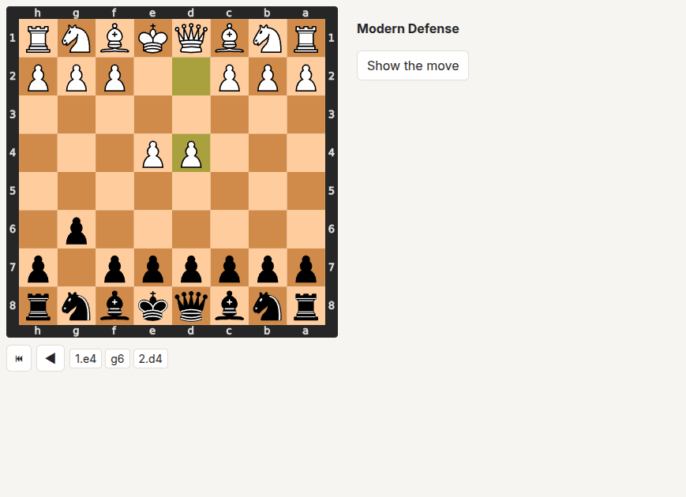
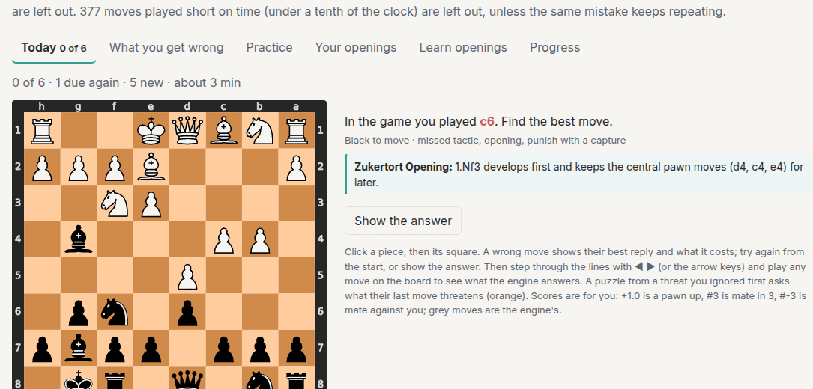
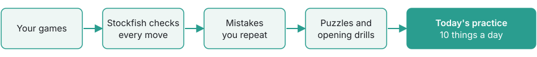

# chess-coach

Chess training built from your own games. It finds the mistakes you keep making and drills you on
those exact positions.

Works with Lichess and Chess.com. Runs on your computer. No account or API key.



Play a wrong move and it shows how you get punished. Wondering about a different move? Play it on
the board and see.

## Get started

You need [uv](https://docs.astral.sh/uv/getting-started/installation/).

```sh
git clone https://github.com/amirradjou/chess-coach
cd chess-coach
uv sync
scripts/get-stockfish.sh    # Linux. Elsewhere, install Stockfish and put it on your PATH.

uv run chess-coach import lichess YOUR_NAME --rated    # or: import chesscom YOUR_NAME
uv run chess-coach sync                                # about 10 minutes per 100 games
uv run chess-coach today                               # opens in your browser
```

`import` takes your last 100 games. Add `--max 500` for more.

After that, `sync` fetches your new games and `today` opens your practice. That's all you need day
to day.

## What's inside

<table>
  <tr>
    <td width="50%" valign="top">
      <b>Today</b><br>
      Ten things a day, reviews first. Short enough to finish.<br><br>
      <a href="docs/screenshots/today.png"></a>
    </td>
    <td width="50%" valign="top">
      <b>What you get wrong</b><br>
      The mistakes you repeat, shown on your own games.<br><br>
      <a href="docs/screenshots/mistakes.png"></a>
    </td>
  </tr>
  <tr>
    <td width="50%" valign="top">
      <b>Practice</b><br>
      Puzzles made from your mistakes. See the best line next to what you played.<br><br>
      <a href="docs/screenshots/practice.png"></a>
    </td>
    <td width="50%" valign="top">
      <b>Your openings</b><br>
      Your score, your usual line, and the moves worth changing.<br><br>
      <a href="docs/screenshots/openings.png"></a>
    </td>
  </tr>
  <tr>
    <td width="50%" valign="top">
      <b>Learn openings</b><br>
      Your openings as a tree of your games, with the mistakes opponents keep making and how to punish them.<br><br>
      <a href="docs/screenshots/learn-openings.png"></a>
    </td>
    <td width="50%" valign="top">
      <b>Progress</b><br>
      How often you go wrong early in a game, compared with public players at each rating.<br><br>
      <a href="docs/screenshots/progress.png"></a>
    </td>
  </tr>
</table>

## How it works



- Stockfish decides what counts as a mistake. The explanations are worked out from the board, so
  no AI is needed. An AI summary is optional.
- Your games stay in a SQLite file on your computer.
- In bullet, only your first 10 moves count. Elsewhere, moves made short on time are ignored unless
  the same mistake keeps coming back.

## More

- [Guide](docs/GUIDE.md): every command and how the numbers are worked out.
- `uv run chess-coach --help` lists the commands in the terminal.
- `uv run pytest` runs the tests, `uv run ruff check . && uv run ruff format .` lints and formats.

MIT licensed, see [LICENSE](LICENSE). Stockfish is GPL-3.0 and is downloaded separately, not
distributed here. Opening names come from
[lichess-org/chess-openings](https://github.com/lichess-org/chess-openings) (CC0).
