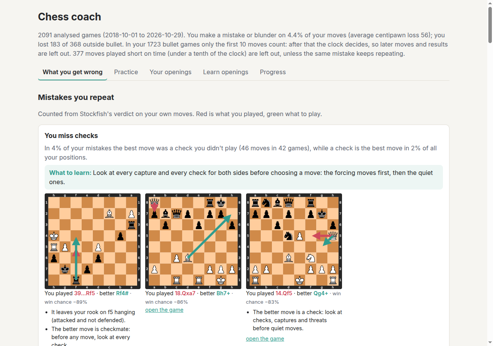
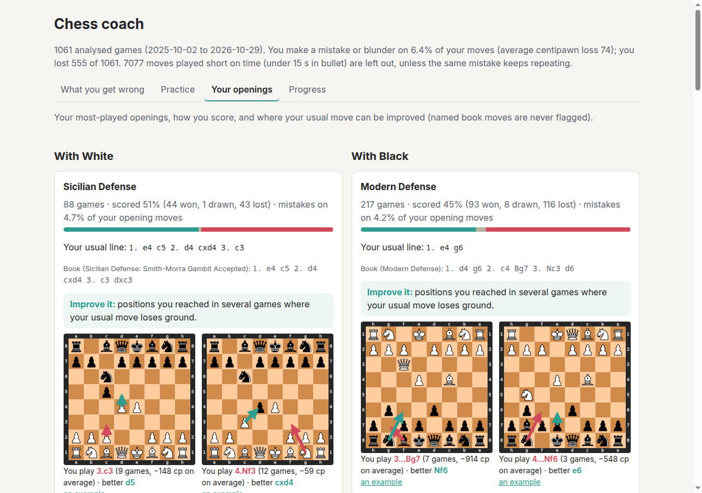

# chess-coach

A coach that reads *your* games, finds the patterns behind your losses, explains them in
plain language, and trains you on exactly those spots.

## What it is

- Pulls your games from Lichess and Chess.com.
- Runs Stockfish over every game to find mistakes, blunders, and missed tactics.
- Instead of the usual per-game "you blundered on move 23", it looks *across* games and
  explains recurring patterns: "you lose when you castle late against the London",
  "you trade queens when behind in development", "you miss back-rank threats after
  move 30 in blitz".
- Generates puzzles from your own positions targeted at those weaknesses, with spaced
  repetition so the ones you keep failing come back.
- Weekly digest: what changed, what to work on next, one opening line to study.

`chess-coach serve` on the author's own Lichess games: the mistakes you repeat, on your own
positions (red arrow: what you played; green: what to play), and your openings with the habitual
moves worth fixing.





## Why build it

Because generic chess trainers don't know you, and a coach that says "here's the
mistake you make every Tuesday" is worth more than a hundred random puzzles. Also
because it is a satisfying shape of project: a hard, exact engine does the truth-finding
and the language model does the explaining — and you can check whether the explanation
was right.

## How it works

```
Lichess / Chess.com APIs, PGN files ──► game store (SQLite, on your machine)
        │
        ▼
Stockfish analysis ──► per-move facts: eval swing, best move and line, motifs, clock
        │
        ▼
pattern mining ──► the situations, moves and openings where you go wrong more than usual
        │
        ├──► digest (Markdown) and the web coach, every claim linked to your moves
        ├──► optional plain-language summary by a model, checked against the evidence
        └──► puzzles from your own mistakes (engine-verified) + spaced repetition drills
```

- **The engine is the source of truth.** The model never judges a move; it explains
  facts the engine established, and every claim cites game IDs and move numbers.
- **Patterns first, explanations second.** Clustering happens in code; the model
  narrates clusters, which keeps hallucinated "patterns" out.
- **Puzzles are verified**: a puzzle only ships if Stockfish confirms a unique, clearly
  better solution.

## What gets measured

- Your mistake rate, centipawn loss and score by month or week (`progress`), with bullet after
  move 10, bullet results and moves made short on time left out.
- Puzzle solve rate per theme, from every attempt.
- Your rating week by week next to the puzzles and opening training you did (`progress`, and
  the Progress page), read from your own games (each stores the rating before the game; bullet
  is left out). Once there are four weeks with practice and four without, it compares how the
  rating moved in each: a comparison, not proof.
- How accurate the model's summaries are, graded by hand: `eval narrate` has the model
  summarise five digests (all games, then the last year, 6, 3 and 1 month) and writes every
  sentence to a sheet next to the facts it was given; you grade the sentences the automatic check
  kept (y: the facts support it, n: they don't, ?: can't tell); `eval score` reports y / (y + n).

## Privacy

Your games, analyses and puzzle history stay in a SQLite file in `data/` on your machine. The
only network calls are the Lichess and Chess.com game exports (public APIs) and, if you ask for
one, the model summary: `--narrate` sends the counted patterns and the cited moves to the model
server you choose (a local Ollama by default), not the games themselves. `serve` binds to localhost and
has no login, so keep it there.

## Stack

Python 3.12 (uv), a Typer + Rich command line, python-chess, Stockfish 19 over UCI, SQLite for
games and per-move facts, and the CC0 [lichess-org/chess-openings](https://github.com/lichess-org/chess-openings)
table for opening names. The web coach is FastAPI with plain JavaScript and python-chess boards.

## Milestones

- **v0 (done)** — import games, run engine analysis, store per-move facts with motif tags.
- **v1 (done)** — pattern mining + a plain-language digest citing games, with an optional
  model-written summary checked against the evidence.
- **v2 (done)** — puzzle generation and spaced repetition drills.
- **v3 (done)** — weekly digests, opening study suggestions, progress tracking.
- **v4 (done)** — the coach in the browser: your recurring mistakes on boards (your move in red,
  the better one in green) with what to learn, click-to-move practice, and your favourite
  openings with the habitual moves to fix and drills for them.
- **v5 (done)** — learn from it: wrong puzzle answers you can explore (their reply, what it costs,
  try again, step through the lines, play any move against the engine), reasons in chess terms
  from the board, and Learn openings: your openings as a tree from your games, with the
  punishment for each opponent mistake and training modes.
- **v6 (done)** — opening training is remembered: every position you answer becomes a card on
  a spaced-repetition schedule, due ones come first, and each opening shows how many
  punishments you've found.
- **v7 (done)** — rating trend against practice: your rating week by week next to the puzzles
  and opening training you did.
- **Next** — keeping current: `sync` fetches, analyses and makes puzzles in one step.

## Status

**v0–v7 done.** Import, analyse, find your patterns, turn your own mistakes into puzzles, drill
them on a schedule, learn and fix your openings, and watch the numbers move, in the terminal or in
the browser (`chess-coach serve`).

**Bullet is not taken seriously.** In a 1-minute game only your first 10 moves count: after
that the clock decides the game, so later moves are left out of everything (patterns, mistake
rates, openings, progress, puzzles), and bullet results never count towards a score or a loss
rate. Problems in those first 10 moves are found like any others.

**Short on time doesn't count either.** In other games a move played with under a tenth of the
clock left is a reflex, so it's left out of the patterns, mistake rates, progress and new puzzles.
Those mistakes only show up, in their own section, when the same one keeps happening: 15+ times
across 8+ games.
[docs/PLAN.md](docs/PLAN.md) has the build plan and how to pick the work up.

- `import lichess|chesscom|pgn` stores games in SQLite with your colour, the speed (Lichess's
  rule) and the opening: Lichess's own header when it has one, otherwise the longest matching
  line in the lichess-org opening table. Re-imports never duplicate a game.
- `analyze` asks Stockfish about every position once and stores, per move: the evaluation
  before and after from the mover's side, the best move and line, centipawn and win-probability
  loss, a Lichess-style judgement (inaccuracy, mistake, blunder), the game phase, the clock, and
  motif tags. It resumes where it stopped and re-runs only at a greater depth (or `--force`).
- `sync` does import, analyse and `puzzles make` for you: it fetches every game since the newest
  one stored for each Lichess and Chess.com account (all or nothing, so a failed download leaves
  no gap), analyses whatever isn't analysed yet, newest first, makes puzzles, and says what came
  in and what's due. Bullet results aren't reported, by the rule above.
- `stats` prints a per-game accuracy table and how often each motif shows up in your moves.
- `digest` slices your moves by phase, colour, speed, opening, move number and clock (and
  pairs of them), and your games by colour, speed, opening, castling and queen trades. It keeps a
  slice only when it has enough moves (30) or games (8), your mistake rate (or loss rate) there
  is well above your own (1.5×, or 1.25× for losses), and the low end of its 95% interval is
  still above it. Each pattern cites its worst moves with links; then a motif table with one
  thing to practise for each. All counted, no model, so it can't invent a pattern.
- `digest --since 7d` is the weekly digest: only those games, compared with the ones before.
  `digest --narrate ollama` adds a short summary from a local model (free); `--narrate
  openrouter --model …` uses any OpenAI-compatible server with `OPENROUTER_API_KEY`. The model
  only explains: any sentence that cites a move outside the evidence is removed. It checks moves,
  not every word, so read it as a gloss on the counted patterns above it.
- `puzzles make` re-checks your costliest moves (20+ points of win probability lost) at depth 18
  with three lines, and keeps a position only when one move is the only mate or beats the next
  best by 150 centipawns, so there is one answer to find. `puzzles list` shows them with their
  motif tags.
- `drill` shows each due puzzle as a board from your side, takes your answer in SAN or UCI,
  shows the engine's line, and schedules the puzzle with SM-2: solved ones come back later and
  later, missed ones tomorrow. Every attempt is kept.
- `progress --by month|week [--speed blitz]` shows your games, score, mistake rate and centipawn
  loss over time, and your puzzle solve rate overall and per tag.
- `openings` lists the openings you score worst in (by your colour), the book line for the one
  you play most, and the opening mistakes you have repeated in more than one game.
- `serve` opens the coach on http://127.0.0.1:8765 (localhost only, no account or key):
  - **What you get wrong**: the mistakes you repeat (which piece and kind of move, captures or
    checks you keep missing, motifs) and the situations where your mistake rate jumps, each with
    a *what to learn* note and your own positions on boards: red arrow your move, green the
    engine's. "Practise these positions" opens the matching drills.
  - **Practice**: due puzzles on a board you click (piece, then square), filtered by theme. A
    wrong move shows their best reply, what it costs in material and score, and lets you try
    again (only the first answer counts for the schedule). Once it's solved or shown you get the
    best line, each of your tries and your game move as lines to step through (◀ ▶ or the arrow
    keys), and any move you play on the board is answered by Stockfish (depth 16, if installed).
  - Every wrong move, example and opening fix also gets reasons in chess terms, worked out from
    the board by `coach/principles.py` (no model): a piece left hanging, castling given up, the
    pawns in front of your castled king pushed, the queen out early, development skipped, a
    centre pawn given away, pawns doubled or isolated, a passed pawn allowed; and what the better
    move does instead (mates, checks or captures, attacks a piece, castles, develops, takes the
    centre, activates the king or pushes a passed pawn in the endgame). Openings you play get a
    short note on what they are about.
  - **Your openings**: your most-played openings with each colour, score, your usual line, the
    book line, and the fixes: positions you reached in several games where your habitual move
    loses ground (named book moves are never flagged), with "Drill these fixes".
  - **Learn openings**: your most-played openings with each colour as a tree of the moves
    actually played in your games (first 8 moves each), with how often each came up, how you
    scored after it and the stored engine verdict. Where your opponent went wrong, it shows the
    punishment (the engine's answer and the score it gives you) and how you actually answered in
    your games. Three modes: *Explore* the tree; *Train your moves*, where they play the replies
    you meet as often as you meet them and you find a sound answer (your usual move if the engine
    rates it fine, else within 0.3 of the engine's best; the engine takes over where your games
    stop); and *Punish their mistakes*, every opponent mistake you've met twice or more, one at a
    time. Your practice is remembered: each position you answer becomes a card scheduled like a
    puzzle (only your first answer of the day counts; showing the move counts as a miss). Due
    punishments come first in the deck, training steers their replies towards positions that are
    due, and each opening shows "you've found 3 of 7 punishments" and how many are due.
  - **Progress**: month by month, your rating and practice week by week (pick the speed), and
    your puzzle solve rate per theme.
- `puzzles make --openings` turns those opening fixes into drills; any move within 30 cp of the
  best counts, since openings often have several good moves. `puzzles prune` drops untried
  puzzles that no longer count (bullet after move 10, moves made short on time).

Motif tags are computed in code from the board and the engine's facts, never by a model:

| Tag | When |
|---|---|
| `hanging_piece`, `hanging_pawn` | the best reply captures something of yours that was undefended, or worth more than the piece taking it |
| `allowed_fork`, `missed_fork` | the best reply attacks two of your pieces (the king, pieces worth more than the attacker, or undefended ones), or your best move would have done that to the opponent |
| `allowed_mate`, `missed_mate` | your move let a forced mate in, or skipped one (up to mate in 6) |
| `back_rank` | that mate is a rook or queen mate on the king's back rank |
| `missed_tactic` | the opponent's previous move lost 20 points of win probability or more, and you didn't punish it |
| `pawn_grab` | an error that captured a pawn |
| `time_trouble` | under 20 s, or under 10% of the starting time, after the move |
| `endgame_conversion` | a winning endgame (+2 or better) let slip below +1 |
| `queen_trade_behind` | before the endgame you traded queens, or allowed the trade, while two or more steps behind in development (minor pieces off their home squares, king moved) |

All tags except `queen_trade_behind` are only set on inaccuracies or worse.

On 84 rated blitz games of a ~1500 Lichess player, analyzed at depth 12, `stats` ends with:

```
      Motifs on your 2626 moves
┏━━━━━━━━━━━━━━━━━━━━┳━━━━━━━┳━━━━━━━┓
┃ motif              ┃ moves ┃ games ┃
┡━━━━━━━━━━━━━━━━━━━━╇━━━━━━━╇━━━━━━━┩
│ missed_tactic      │    37 │    26 │
│ time_trouble       │    30 │    13 │
│ hanging_piece      │    29 │    23 │
│ pawn_grab          │    26 │    23 │
│ endgame_conversion │    17 │    12 │
│ hanging_pawn       │    12 │    12 │
│ allowed_mate       │    10 │     8 │
│ missed_fork        │     6 │     6 │
│ allowed_fork       │     4 │     4 │
│ missed_mate        │     2 │     2 │
│ back_rank          │     2 │     2 │
└────────────────────┴───────┴───────┘
```

## Getting started

```sh
uv sync                     # install
scripts/get-stockfish.sh    # fetch a Stockfish binary into ./.stockfish (no sudo needed)

uv run chess-coach import lichess <username> --max 100 --rated   # LICHESS_TOKEN raises the rate limit
uv run chess-coach import chesscom <username> --since 3m
uv run chess-coach import pgn games.pgn --user "<your name in the PGN>"
uv run chess-coach sync                                          # later: fetch, analyse, make puzzles
uv run chess-coach games                                         # what is stored
uv run chess-coach analyze --depth 12 --threads 4
uv run chess-coach stats
uv run chess-coach digest -o digest.md                           # patterns across your games
uv run chess-coach digest --since 7d                             # this week vs before
uv run chess-coach puzzles make --limit 50                       # your mistakes as puzzles
uv run chess-coach drill                                         # practise what is due
uv run chess-coach progress --by week
uv run chess-coach openings
uv run chess-coach puzzles make --openings                      # drills for your opening fixes
uv run chess-coach serve --open                                  # the coach in your browser
```

`analyze --newest` starts with your latest games, so a big import is useful early.

After the first import, `sync` keeps the coach current in one step: new games from every Lichess
and Chess.com account already stored, analysis, and puzzles from the new mistakes. Run it daily or
weekly (`--threads 8` speeds it up).

`--db <file>` picks another database (default `data/chess-coach.db`).

## Development

```sh
uv run pytest                                   # tests (engine tests skip without Stockfish)
uv run ruff check . && uv run ruff format .     # lint + format
```

## License

MIT, see [LICENSE](LICENSE). Stockfish is GPL-3.0 and is downloaded separately by
`scripts/get-stockfish.sh`, not distributed here. The opening names come from
[lichess-org/chess-openings](https://github.com/lichess-org/chess-openings) (CC0).
